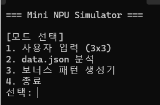
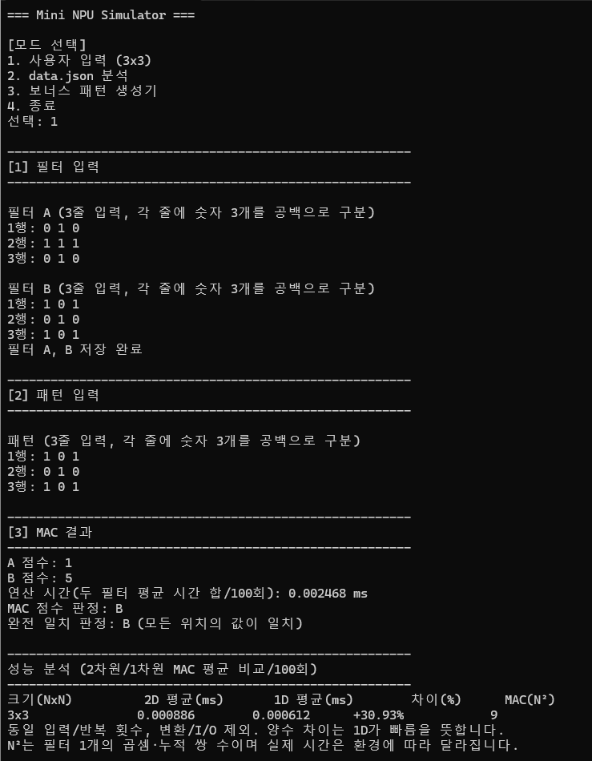
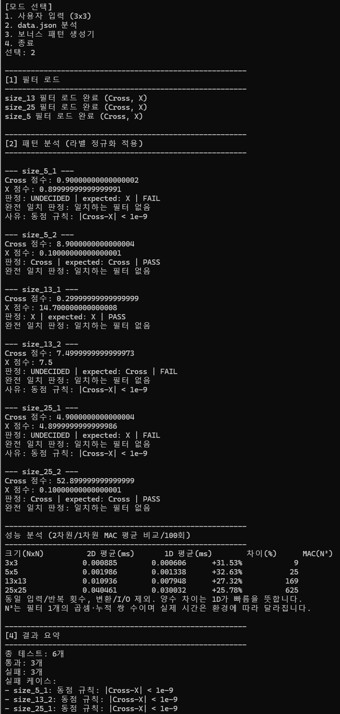
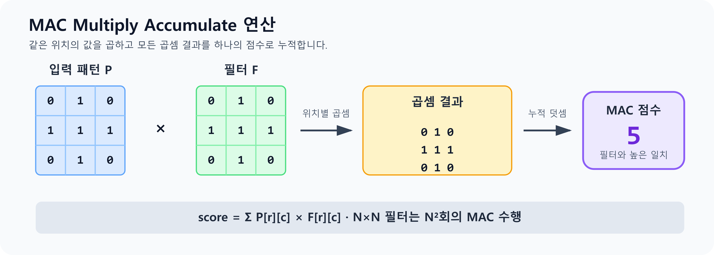
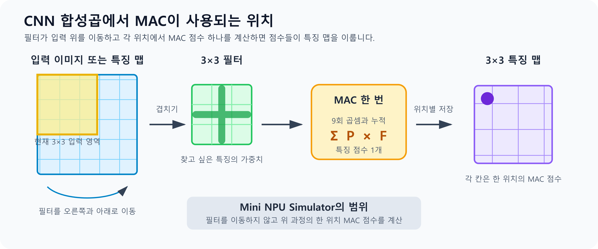

# Mini NPU Simulator

「3주차 과제」의 2번 최종 결과물과 4번 기능 요구 사항을 구현한 Python 콘솔 애플리케이션입니다.
8번 예시의 흐름에 맞춰 필터 점수, 판정, 성능 표, 결과 요약을 출력합니다.
Python 3.8 이상에서 실행하며 외부 패키지를 설치하지 않습니다.

## 최종 결과물

### 1 사용자 입력 3×3

- 입력/요청: 3×3 필터 2개(A, B)와 3×3 패턴을 콘솔로 입력합니다.
- 출력/화면: 두 필터의 MAC 점수, 연산 시간(ms), 판정 결과(A/B/판정 불가)를 출력합니다.

### 2 JSON 데이터 분석

- 입력/요청: `data.json`에서 필터(5×5, 13×13, 25×25)와 패턴을 불러와 일괄 판정합니다.
- 출력/화면: 케이스별 판정(Cross/X/UNDECIDED)과 expected 비교(PASS/FAIL)를 출력합니다.

### 3 성능 분석

- 입력/요청: 크기별 MAC 연산 시간을 최소 10회 이상 반복 측정합니다.
- 출력/화면: 크기별 평균 연산 시간(ms)과 연산 횟수(N²)를 표로 출력합니다.
- 보너스 구현: 동일 입력과 반복 횟수로 2차원 배열 MAC과 1차원 배열 MAC의 성능을 비교합니다.

### 4 결과 리포트

- 콘솔: 전체 테스트 수, 통과 수, 실패 수와 실패 케이스 목록을 요약합니다.
- README: 라벨/스키마, 부동소수점, 비교 정책에 따른 실패 원인과 시간 복잡도를 분석합니다.
- 제공 `data.json`의 실제 결과는 총 6건, PASS 3건, FAIL 3건입니다.

## 실행 화면 캡처

아래 세 장으로 최종 결과물의 필수 기능과 출력이 모두 확인됩니다. Windows 터미널의
가로 폭을 충분히 넓히고, 명령어부터 결과까지 보이도록 캡처합니다. 이미지는
`assets/screenshots` 폴더에 다음 파일명으로 저장합니다.

| 번호 | 상태 | 파일명 | 반드시 포함할 내용 |
| ---: | :---: | --- | --- |
| 1 | 완료 | `01_menu.png` | 프로그램 제목과 모드 1~4 선택 화면 |
| 2 | 완료 | `02_manual_result.png` | A/B 점수, 연산 시간, MAC 판정, 완전 일치 판정 |
| 3 | 완료 | `03_json_cases.png` | JSON 케이스별 Cross/X 점수, expected, PASS/FAIL |
| 4 | 완료 | `03_json_cases.png`에 포함 | 크기별 성능 표와 총 6건/PASS 3건/FAIL 3건 요약 |

준비된 캡처를 아래에 표시합니다. 세 번째 캡처에 JSON 분석, 성능 분석과 결과 요약이
모두 들어 있어 별도의 네 번째 이미지는 사용하지 않습니다.

### 실행 메뉴



### 사용자 입력 결과



### JSON 케이스 분석 성능 분석 및 결과 요약



### 캡처 1 실행 메뉴 완료

```powershell
cd C:\cdsy\3rd\mini_npu
python main.py
```

아무 번호도 입력하지 않은 상태에서 프로그램 제목과 1~4번 메뉴가 모두 보이게 캡처합니다.
캡처 후 `4`를 입력해 종료합니다.

### 캡처 2 사용자 입력 결과

```powershell
python main.py --mode 1 --once --no-pause --repeats 100
```

필터 A, 필터 B, 패턴 순서로 다음 값을 입력합니다.

```text
필터 A
0 1 0
1 1 1
0 1 0

필터 B
1 0 1
0 1 0
1 0 1

패턴
1 0 1
0 1 0
1 0 1
```

출력의 `A 점수: 1`, `B 점수: 5`, 연산 시간, `MAC 점수 판정: B`,
`완전 일치 판정: B`가 한 화면에 보이도록 캡처합니다.

### 캡처 3 JSON 분석 성능 분석 및 결과 요약 완료

```powershell
python main.py --mode 2 --once --no-pause --repeats 100
```

완료된 이미지에는 6개 케이스의 Cross/X 점수, expected, PASS/FAIL과 3×3, 5×5,
13×13, 25×25의 2D/1D 평균 시간, N² 연산 횟수 및 다음 결과 요약이 함께 포함되어 있습니다.

```text
총 테스트: 6개
통과: 3개
실패: 3개
```

## MAC 연산이란

MAC은 **Multiply-Accumulate(곱셈-누적)**의 약자입니다. 두 배열에서 같은 위치에 있는
값을 서로 곱하고, 모든 곱셈 결과를 하나의 합으로 누적하는 연산입니다. 입력 패턴을
`P`, 필터를 `F`, 한 변의 크기를 `N`이라고 하면 이 프로그램의 MAC 점수는 다음과 같습니다.



```text
score = Σ(r=0..N-1) Σ(c=0..N-1) P[r][c] × F[r][c]
```

예를 들어 입력과 필터의 같은 위치에 `1`이 많이 겹칠수록 점수가 커지므로, 점수를 두
필터와 비교하면 입력이 어느 필터에 더 가까운지 판단할 수 있습니다. N×N 입력과 필터
한 쌍을 계산할 때 곱셈·누적은 N²회 수행되므로 시간 복잡도는 `O(N²)`입니다.

MAC은 단순한 연산이지만 신경망에서는 매우 많은 횟수로 반복됩니다. NPU는 이러한
곱셈과 누적을 여러 개 동시에 처리하도록 설계된 AI 연산 장치입니다. 이 프로그램은
실제 NPU 하드웨어를 사용하는 것이 아니라, Python 반복문으로 MAC의 원리를 재현합니다.

### MAC 연산 사례

다음 3×3 입력 패턴은 십자가 모양입니다. 이 입력을 Cross 필터와 X 필터에 각각 적용해
어느 필터의 MAC 점수가 더 큰지 비교합니다.

```text
입력 패턴 P          Cross 필터 A        X 필터 B
0 1 0               0 1 0               1 0 1
1 1 1               1 1 1               0 1 0
0 1 0               0 1 0               1 0 1
```

#### 사례 1 Cross 필터와 MAC

입력과 Cross 필터에서 같은 위치의 값끼리 곱합니다.

```text
입력 × Cross 필터              위치별 곱셈 결과

0×0   1×1   0×0               0 1 0
1×1   1×1   1×1       →       1 1 1
0×0   1×1   0×0               0 1 0
```

각 곱셈 결과를 모두 더합니다.

```text
Cross 점수 = 0 + 1 + 0 + 1 + 1 + 1 + 0 + 1 + 0
            = 5
```

Cross 모양의 1 위치 다섯 곳이 입력과 모두 겹치므로 MAC 점수는 5입니다.

#### 사례 2 X 필터와 MAC

같은 입력을 X 필터에도 적용합니다.

```text
입력 × X 필터                  위치별 곱셈 결과

0×1   1×0   0×1               0 0 0
1×0   1×1   1×0       →       0 1 0
0×1   1×0   0×1               0 0 0
```

```text
X 점수 = 0 + 0 + 0 + 0 + 1 + 0 + 0 + 0 + 0
        = 1
```

입력과 X 필터는 가운데 위치의 1만 겹치므로 MAC 점수는 1입니다.

#### 두 점수 비교와 판정

```text
Cross 점수: 5
X 점수:     1

5 > 1  →  최종 판정: Cross
```

두 점수의 차이는 4로 epsilon `1e-9`보다 훨씬 크기 때문에 동점이 아닙니다. 따라서 더 큰
점수를 얻은 Cross가 최종 판정이 됩니다. 이 사례처럼 MAC 점수는 입력과 필터에서 활성화된
값이 같은 위치에 많이 겹칠수록 커지며, 두 필터 중 입력과 더 유사한 모양을 선택하는 근거로
사용할 수 있습니다.

단, MAC 점수는 위치별 곱의 합이므로 점수가 크다는 사실만으로 모든 원소가 완전히 같다는
뜻은 아닙니다. 그래서 이 프로그램은 MAC 판정과 별도로 0 위치까지 모두 비교하는
`완전 일치 판정`도 출력합니다. 위 사례의 입력은 Cross 필터와 모든 위치가 같으므로 완전
일치 결과도 Cross입니다.

## CNN이란

CNN은 **Convolutional Neural Network(합성곱 신경망)**의 약자로, 이미지처럼 공간적인
구조를 가진 데이터를 처리하는 데 널리 사용되는 신경망입니다. CNN의 합성곱 계층은
작은 필터(커널)를 입력 위에서 이동시키면서 각 위치의 입력 영역과 필터 사이의 점수를
계산합니다. 이렇게 얻은 점수들을 배치하면 특징 맵(feature map)이 만들어집니다.

CNN의 앞쪽 계층은 선, 모서리와 단순한 무늬 같은 특징을 찾고, 뒤쪽 계층은 여러 특징을
조합해 더 복잡한 형태를 표현할 수 있습니다. 실제 CNN에는 합성곱 외에도 bias, 활성화
함수(ReLU 등), pooling, 여러 입력·출력 채널이 사용될 수 있습니다. 학습 과정에서는
손실 함수와 역전파를 이용해 필터의 가중치를 자동으로 갱신합니다.



#### CNN의 발전 흐름

- 1983년 CNN의 초기 모형인 **Neocognitron**이 발표되었습니다.
- 1998년 LeCun이 손글씨 숫자 인식에 사용된 **LeNet-5**를 발표했습니다.
- 2012년 **AlexNet**이 ImageNet 대회에서 뛰어난 성능을 보이면서 CNN 연구가 크게
  활성화되었습니다.
- 이후 **GoogLeNet**, **VGGNet**, **ResNet**처럼 더 깊고 성능이 좋은 CNN 구조가
  계속 등장했습니다.

이 발전 과정의 핵심은 단순히 신경망을 깊게 만드는 것만이 아니라, 이미지의 공간적
구조를 유지하면서 필요한 특징을 효율적으로 찾아내는 **합성곱 계층**을 활용하는 데
있습니다.

#### 합성곱과 특징 맵이 만들어지는 과정

합성곱에서는 작은 필터를 이미지의 왼쪽 위부터 일정한 간격으로 이동시킵니다. 필터가
놓인 위치마다 이미지의 일부 영역과 필터를 위치별로 곱하고 모두 더합니다. 이 계산이
한 번의 MAC이며, 그 결과가 출력의 한 칸에 저장됩니다. 모든 위치에서 계산한 점수를
배열로 모은 것이 **특징 맵(feature map 또는 activation map)**입니다.

강의자료의 첫 번째 위치 계산은 다음과 같습니다.

```text
이미지의 왼쪽 위 3×3 영역        3×3 필터
┌          ┐                     ┌       ┐
│  1  1  2 │                     │ 1 0 1 │
│ -2  3  0 │                     │ 0 1 0 │
│  1  1  2 │                     │ 1 0 1 │
└          ┘                     └       ┘

MAC = 1×1 + 1×0 + 2×1
    + (-2)×0 + 3×1 + 0×0
    + 1×1 + 1×0 + 2×1
    = 9
```

필터를 한 칸씩 옮기며 같은 계산을 반복하면 다음 3×3 특징 맵이 만들어집니다.

```text
┌       ┐
│ 9 7 9 │
│ 1 8 6 │
│ 5 6 6 │
└       ┘
```

각 숫자는 해당 위치의 이미지 영역이 필터가 찾으려는 모양과 얼마나 강하게 반응했는지를
나타냅니다. 예를 들어 `9`는 그 위치에서 필터와 이미지 영역의 대응값을 곱해 누적한
결과입니다. 필터가 이동하므로 하나의 점수가 아니라 위치 정보가 유지된 특징 맵을 얻을
수 있습니다.

#### Stride: 필터를 이동하는 간격

**Stride**는 필터가 한 번에 이동하는 칸 수입니다. `stride=1`이면 한 칸씩 이동하여
세밀한 특징 맵을 만들고, `stride=2`이면 두 칸씩 이동하므로 계산 위치와 출력 크기가
줄어듭니다. 위 예제에서 stride를 2로 설정하면 특징 맵은 다음과 같이 2×2가 됩니다.

```text
stride=1 출력       stride=2 출력
┌       ┐            ┌     ┐
│ 9 7 9 │            │ 9 9 │
│ 1 8 6 │            │ 5 6 │
│ 5 6 6 │            └     ┘
└       ┘
```

Padding이 없을 때 한 변의 출력 크기는 다음 식으로 구할 수 있습니다.

```text
출력 크기 = floor((입력 크기 - 필터 크기) / stride) + 1

5×5 입력, 3×3 필터, stride=1 → (5-3)/1+1 = 3 → 3×3 출력
5×5 입력, 3×3 필터, stride=2 → (5-3)/2+1 = 2 → 2×2 출력
```

#### 컬러 이미지와 3차원 필터

컬러 이미지는 보통 RGB 채널을 가지므로 `가로×세로×깊이`의 3차원 데이터입니다. 따라서
입력이 `32×32×3`이라면 필터도 입력의 모든 채널을 볼 수 있도록 `5×5×3`처럼 깊이가
3이어야 합니다. 이 필터 하나를 stride 1, padding 없이 이동시키면 `28×28` 특징 맵
하나가 만들어집니다.

필터는 CNN이 학습하는 **가중치(weight)**입니다. 필터가 여러 개이면 필터마다 서로 다른
특징 맵을 하나씩 만들며, 이 특징 맵의 개수가 다음 계층 입력의 깊이가 됩니다. 따라서
다음 합성곱 계층의 필터 깊이는 바로 앞 계층이 출력한 특징 맵의 깊이와 같아야 합니다.

#### Bias, 활성화 함수, 다음 계층

CNN은 MAC 결과를 그대로 끝내지 않습니다. 일반적으로 합성곱 결과에 필터별 bias를 더하고
ReLU 같은 활성화 함수 `σ`를 적용합니다.

```text
z = convolution(입력, 필터) + bias
a = σ(z)

입력 이미지 → 합성곱(MAC) → bias 더하기 → 활성화 함수 → 특징 맵
                                                      ↓
                                             다음 계층의 입력
```

이 과정을 여러 계층에서 반복하면 앞 계층은 선이나 모서리 같은 단순 특징을, 뒤 계층은
그 특징을 조합한 복잡한 형태를 표현할 수 있습니다. 즉, CNN은 **필터의 MAC 계산으로
특징을 찾고, 특징 맵을 다음 계층에 전달하면서 단계적으로 더 복잡한 정보를 학습하는
신경망**입니다.

## CNN과 MAC의 관계와 유사점

CNN의 합성곱 한 위치에서 수행하는 핵심 계산이 MAC입니다. 필터를 입력의 한 영역에
겹친 다음 같은 위치의 값끼리 곱하고 모두 더해 특징 점수 하나를 만들기 때문입니다.

| 비교 항목 | 이 Mini NPU 시뮬레이터 | 일반적인 CNN |
| --- | --- | --- |
| 핵심 계산 | 입력과 필터의 위치별 곱셈 후 누적 | 입력 영역과 커널의 위치별 곱셈 후 누적 |
| 결과 의미 | 필터와 입력 패턴의 유사도 점수 | 해당 위치에서 특정 특징이 나타나는 정도 |
| 반복 구조 | N×N 원소에 대해 MAC 반복 | 모든 위치, 필터, 채널에 대해 MAC 반복 |
| 필터 | 사용자 입력 또는 JSON/생성기로 제공 | 학습을 통해 가중치가 갱신될 수 있음 |
| 출력 | 필터별 점수와 판정 | 여러 위치의 점수로 구성된 특징 맵 |

두 방식의 공통점은 필터의 값과 입력값을 대응시켜 곱하고 누적한 결과로 특징의 강도를
수치화한다는 것입니다. 입력과 필터가 잘 맞으면 일반적으로 점수가 커집니다. 또한 입력
크기, 필터 수, 채널 수가 증가할수록 MAC 횟수가 크게 늘어나므로 병렬 연산 장치의 이점을
얻을 수 있습니다.

다만 현재 프로그램은 입력과 필터의 크기가 같고 필터를 이동시키지 않으므로 점수 하나만
계산합니다. 따라서 CNN 전체를 구현한 것은 아니며, CNN 합성곱의 **한 위치에서 일어나는
핵심 MAC 계산을 단순화하여 보여 주는 시뮬레이터**입니다. stride, padding, 특징 맵,
다중 채널, 활성화 함수, pooling, 학습과 역전파는 현재 구현 범위에 포함되지 않습니다.

## 나머지 과제 목표 이해하기

### data.json 키 규칙과 라벨 정규화

`data.json`은 크게 `filters`와 `patterns` 두 영역으로 구성됩니다. `filters`에는 크기별
Cross/X 필터가 있고, `patterns`에는 판정할 입력과 정답 라벨이 있습니다.

```text
filters
├─ size_5   → 5×5 Cross/X 필터
├─ size_13  → 13×13 Cross/X 필터
└─ size_25  → 25×25 Cross/X 필터

patterns
├─ size_5_1   → 5×5 입력의 1번 케이스
├─ size_13_2  → 13×13 입력의 2번 케이스
└─ size_25_2  → 25×25 입력의 2번 케이스
```

패턴 키는 `size_{N}_{idx}` 규칙을 사용합니다. 예를 들어 `size_13_2`에서 `13`은 행렬
크기이고 `2`는 케이스 번호입니다. 프로그램은 키에서 `13`을 읽어 `filters.size_13`의
Cross와 X 필터를 자동으로 선택합니다. 그다음 입력 행렬도 실제로 13×13인지 확인합니다.

JSON에는 같은 뜻을 가진 라벨이 서로 다른 문자로 들어올 수 있습니다. 제공 데이터의
`expected`에는 `+`와 `x`가 사용되고 필터 키에는 `cross`와 `x`가 사용됩니다. 프로그램은
비교 전에 다음과 같이 표준 라벨로 바꿉니다.

| 원래 입력 | 표준 라벨 |
| --- | --- |
| `+`, `cross`, `Cross` | `Cross` |
| `x`, `X` | `X` |

이 과정을 **라벨 정규화**라고 합니다. 정규화하지 않으면 `+`와 `Cross`가 같은 뜻인데도
문자열이 다르다는 이유로 FAIL이 될 수 있습니다. 예를 들어 `size_5_2`의 expected `+`는
먼저 `Cross`로 변환되고, MAC 판정 `Cross`와 비교되어 PASS가 됩니다.

정규화는 표기만 통일할 뿐 점수나 정답을 임의로 변경하지 않습니다. 알 수 없는 라벨이
들어오면 억지로 추측하지 않고 해당 케이스를 데이터 오류로 기록합니다.

### 부동소수점 오차와 epsilon 비교

컴퓨터는 대부분의 실수를 2진 부동소수점으로 저장합니다. `0.1`, `0.3`, `0.9` 같은 값은
2진수로 정확히 끝나지 않기 때문에 아주 가까운 근삿값으로 저장됩니다. 여러 값을 곱하고
더하면 이 작은 오차가 누적될 수 있습니다.

제공 데이터의 `size_5_1`은 수학적으로 두 점수가 모두 0.9인 동점이지만 실제 출력은
다음처럼 마지막 자릿수가 다릅니다.

```text
Cross 점수: 0.90000000000000002
X 점수:     0.89999999999999991
```

단순히 `Cross > X`만 검사하면 Cross가 이긴 것으로 잘못 판단할 수 있습니다. 그래서 이
프로그램은 두 점수의 차이가 `1e-9`보다 작은지 먼저 확인합니다.

```text
abs(Cross 점수 - X 점수) < 1e-9  →  UNDECIDED
```

두 점수의 차이는 약 `1.11e-16`으로 `1e-9`보다 훨씬 작으므로 실제 우열이 없는 동점으로
처리합니다. `size_13_2`와 `size_25_1`도 같은 이유로 UNDECIDED입니다. expected는 Cross
또는 X이므로 이 세 케이스는 FAIL이지만, 이는 계산 오류가 아니라 정해진 동점 정책을
정확히 적용한 결과입니다.

epsilon을 너무 크게 잡으면 실제로 다른 점수도 동점이 되고, 너무 작게 잡으면 표현 오차를
우열로 오해할 수 있습니다. 이 과제는 `1e-9`를 기준으로 사용하며, 차이가 정확히 `1e-9`인
경우에는 `<` 조건을 만족하지 않으므로 점수가 큰 필터를 선택합니다.

### 크기별 연산 시간과 O(N²)

N×N 패턴과 필터의 MAC은 모든 행과 열을 한 번씩 방문합니다. 위치마다 곱셈 한 번과 누적
한 번을 수행하므로 핵심 연산 횟수는 `N × N = N²`입니다.

| 크기 | MAC 곱셈·누적 쌍 | 3×3 대비 이론적 작업량 |
| ---: | ---: | ---: |
| 3×3 | 9 | 1배 |
| 5×5 | 25 | 약 2.78배 |
| 13×13 | 169 | 약 18.78배 |
| 25×25 | 625 | 약 69.44배 |

N이 2배가 되면 원소 수는 약 4배가 됩니다. 따라서 입력 크기가 커질수록 실행 시간도
대체로 N²에 비례해 증가하며 시간 복잡도는 `O(N²)`입니다. 두 필터를 계산하면 `2N²`이지만
상수 2는 Big-O에서 생략하므로 여전히 `O(N²)`입니다.

프로그램은 우연한 시간 변동을 줄이기 위해 한 번 워밍업한 뒤 기본 100회 반복 측정의
평균을 출력합니다. 파일 읽기, 사용자 입력, 화면 출력과 1차원 배열 변환 시간은 측정에서
제외하고 MAC 함수 실행 구간만 측정합니다. 운영체제 상태와 Python 반복문 비용 때문에
실측 시간이 정확히 9:25:169:625 비율이 되지는 않지만, 행렬이 커질수록 작업량과 시간이
증가하는 전체 경향을 확인할 수 있습니다.

### 실패 원인 분류와 진단 방법

FAIL이 발생했다고 해서 모두 프로그램 로직의 버그인 것은 아닙니다. 먼저 실패를
**데이터/스키마 문제**, **로직 문제**, **수치 비교 문제**로 분리해야 합니다.

| 분류 | 대표 증상 | 확인 방법 | 대응 방법 |
| --- | --- | --- | --- |
| 데이터/스키마 | 키 형식 오류, 필터 누락, 행·열 크기 불일치, 알 수 없는 라벨 | 오류 메시지에서 케이스 ID와 입력 구조 확인 | JSON 키·크기·라벨을 규칙에 맞게 수정하고 다른 케이스 분석은 계속 수행 |
| 로직 | 손으로 계산한 점수와 프로그램 점수가 다름, 모든 케이스가 같은 판정, 2D/1D 점수 불일치 | 3×3 기준 예제와 자동 테스트로 MAC·판정 함수 확인 | 반복문 인덱스, 누적 변수, 필터 선택과 비교 조건 수정 |
| 수치 비교 | 수학적으로 동점인데 마지막 자릿수만 다름, UNDECIDED 발생 | `abs(score_a-score_b)`와 epsilon 비교 | 직접 `==`나 단순 `>` 대신 정해진 epsilon 정책 적용 |

진단 순서는 다음과 같습니다.

1. 케이스 키에서 N을 올바르게 읽었는지 확인합니다.
2. 선택된 필터와 입력이 모두 N×N인지 확인합니다.
3. expected와 필터 라벨이 Cross/X로 정규화됐는지 확인합니다.
4. 작은 3×3 예제를 손으로 계산해 MAC 점수가 같은지 확인합니다.
5. 점수 차이가 epsilon보다 작은지 확인합니다.
6. 데이터 FAIL과 프로그램 실행 오류를 구분해 결과 리포트에 원인을 기록합니다.

현재 제공 데이터의 FAIL 3건은 모두 **수치 비교 문제를 epsilon 정책으로 올바르게 처리한
UNDECIDED 결과**입니다. FAIL 수를 줄이기 위해 expected, 필터 값이나 동점 정책을 임의로
바꾸면 안 됩니다. 반면 크기 불일치나 필터 누락은 데이터/스키마 문제로 기록하고, 한
케이스의 오류 때문에 전체 프로그램이 중단되지 않도록 다음 케이스 분석을 계속합니다.

## 프로그램 구문과 요구사항 대응

이 절은 과제의 기능 요구사항이 실제 프로그램에서 어떤 구문으로 구현됐는지 보여 줍니다.
아래 코드는 `main.py`의 핵심 부분이며 전체 실행 코드는 같은 폴더의 `main.py`에서 확인할
수 있습니다. NumPy, pandas 같은 외부 라이브러리는 사용하지 않고 Python 표준 라이브러리의
`json`, `math`, `re`, `time`, `pathlib`, `argparse` 등을 사용합니다.

### 1 N×N 데이터 저장과 위치별 읽기 쓰기

`Matrix`는 입력 행의 개수와 각 행의 열 개수가 N인지 검사한 뒤 2차원 리스트로 저장합니다.
`get()`과 `set()`은 0부터 시작하는 행·열 좌표로 값을 읽고 씁니다. 생성자에 크기를 전달하므로
3×3, 5×5, 13×13, 25×25뿐 아니라 1 이상의 임의 N×N 행렬도 처리할 수 있습니다.

```python
class Matrix:
    def __init__(self, rows, size=None):
        # 최상위 값이 비어 있지 않은 리스트인지 확인한다.
        if not isinstance(rows, list) or not rows:
            raise ValueError("행렬은 비어 있지 않은 2차원 배열이어야 합니다.")

        # size를 생략하면 입력된 행의 개수를 N으로 사용한다.
        self.size = len(rows) if size is None else size

        # 행의 개수가 N과 다르면 정사각 행렬이 아니므로 거부한다.
        if self.size < 1 or len(rows) != self.size:
            raise ValueError("행 수 불일치")

        self.rows = []
        # 각 행을 하나씩 검사하여 열도 정확히 N개인지 확인한다.
        for index, row in enumerate(rows, 1):
            if not isinstance(row, list) or len(row) != self.size:
                raise ValueError("{}행 열 수 불일치".format(index))

            # 모든 원소를 유한한 숫자로 검증한 뒤 2차원 리스트에 저장한다.
            self.rows.append([self.number(value) for value in row])

    def _check(self, row, col):
        # 음수 좌표와 N 이상인 좌표의 접근을 막는다.
        if not (0 <= row < self.size and 0 <= col < self.size):
            raise IndexError("행렬 좌표 범위를 벗어났습니다.")

    def get(self, row, col):
        # 좌표가 유효할 때만 해당 위치의 값을 반환한다.
        self._check(row, col)
        return self.rows[row][col]

    def set(self, row, col, value):
        # 좌표와 새 값을 모두 검증한 뒤 해당 위치에 저장한다.
        self._check(row, col)
        self.rows[row][col] = self.number(value)
```

### 2 모드 1의 3×3 입력과 재입력 검증

필터 A, 필터 B와 패턴은 모두 `read_matrix()`로 한 줄씩 입력받습니다. 유효한 행 세 개가
저장될 때까지 반복하며, 열이 3개가 아니거나 숫자로 바꿀 수 없거나 NaN/Infinity이면 해당
행을 저장하지 않고 같은 행을 다시 입력받습니다.

```python
@staticmethod
def read_matrix(name):
    print("\n{} (3줄 입력, 각 줄에 숫자 3개를 공백으로 구분)".format(name))
    rows = []

    # 유효한 행이 3개 저장될 때까지 같은 입력 과정을 반복한다.
    while len(rows) < 3:
        try:
            # 공백을 기준으로 한 줄을 여러 값으로 나눈다.
            parts = input("{}행: ".format(len(rows) + 1)).split()

            # 3×3 입력이므로 한 행에는 값이 정확히 3개 있어야 한다.
            if len(parts) != 3:
                raise ValueError("열 수 오류")

            # 문자열을 float로 변환하고 NaN/Infinity 여부도 검사한다.
            row = [Matrix.number(float(part)) for part in parts]
            rows.append(row)
        except (ValueError, OverflowError):
            # 잘못된 행은 저장하지 않으므로 다음 반복에서 같은 행을 다시 받는다.
            print("입력 형식 오류: 각 줄에 3개의 유한한 숫자를 공백으로 구분해 입력하세요.")

    # 검증을 통과한 세 행으로 3×3 Matrix를 만든다.
    return Matrix(rows, 3)

def manual(self):
    # 두 필터를 먼저 입력하고 저장 완료 메시지를 출력한다.
    a = self.read_matrix("필터 A")
    b = self.read_matrix("필터 B")
    print("필터 A, B 저장 완료")

    # 같은 입력 함수를 재사용해 판정할 패턴을 받는다.
    pattern = self.read_matrix("패턴")
```

### 3 JSON 로드와 최상위 스키마 검증

**스키마(schema)**는 데이터가 따라야 하는 구조와 규칙을 뜻합니다. 쉽게 말해 JSON 데이터의
"설계도"입니다. 어떤 키가 반드시 있어야 하는지, 각 값이 객체·배열·문자열 중 어떤 형식인지,
배열의 크기와 이름 규칙은 무엇인지 정의합니다. 프로그램은 실제 데이터가 이 설계도와
일치하는지 확인하는데, 이 과정을 **스키마 검증**이라고 합니다.

이 과제에서 사용하는 주요 스키마 규칙은 다음과 같습니다.

| 검사 대상 | 스키마 규칙 | 잘못된 예 |
| --- | --- | --- |
| 최상위 | JSON 객체이며 `filters`, `patterns`를 포함 | 최상위가 배열 `[]`인 경우 |
| 필터 그룹 | `size_5`, `size_13`, `size_25` 객체 | `size5`, `filter_5`처럼 이름이 다른 경우 |
| 필터 라벨 | 그룹마다 `cross`, `x` 필터가 모두 존재 | X 필터가 누락된 경우 |
| 패턴 키 | `size_{N}_{idx}` 형식 | `pattern1`, `size_x_1` |
| 패턴 항목 | `input` 2차원 배열과 `expected` 문자열 포함 | expected가 없거나 input이 문자열인 경우 |
| 행렬 크기 | 키의 N과 input 및 필터의 행·열 수가 일치 | `size_5_1`인데 input이 3×3인 경우 |

스키마 검증은 계산을 시작하기 전에 잘못된 데이터의 위치와 이유를 알려 줍니다. 검증 없이
계산하면 필터가 누락되거나 크기가 다른 행렬을 곱하는 과정에서 프로그램이 갑자기 종료되거나
의미 없는 점수가 만들어질 수 있습니다.

모드 2는 UTF-8 JSON 파일을 읽고 최상위 객체와 `patterns`의 형식을 검사합니다. 파일 누락,
문법 오류 또는 최상위 스키마 오류가 발생하면 원인을 출력하고 오류 코드 1을 반환합니다.
반복 메뉴에서 실행했다면 프로그램이 종료되지 않고 메뉴로 복귀합니다.

```python
# UTF-8 또는 UTF-8 BOM 형식의 data.json을 연다.
with path.open(encoding="utf-8-sig") as stream:
    # JSON 문자열을 Python 객체로 변환한다.
    document = json.load(stream)

# 스키마 규칙 1: JSON 최상위는 키와 값을 가진 객체여야 한다.
if not isinstance(document, dict):
    raise ValueError("JSON 최상위는 객체여야 합니다.")

# 스키마 규칙 2: patterns는 비어 있지 않은 객체여야 한다.
patterns = document.get("patterns")
if not isinstance(patterns, dict) or not patterns:
    raise ValueError("patterns는 비어 있지 않은 객체여야 합니다.")

# 스키마 규칙 3: filters도 객체여야 한다.
raw_filters = document.get("filters")
if not isinstance(raw_filters, dict):
    # 필터 오류를 각 케이스의 FAIL 사유로 남기기 위해 빈 객체로 계속 검증한다.
    print("filters 누락 또는 객체 형식 오류: 모든 케이스에서 검증합니다.")
    raw_filters = {}
```

### 4 패턴 키 해석과 크기 일치 검증

정규식 `size_([1-9][0-9]*)_([0-9]+)`로 `size_{N}_{idx}` 키에서 N을 추출합니다.
추출한 N으로 `size_N` 필터를 선택하고 `Matrix(..., size)`가 패턴의 실제 행·열 크기를
검사합니다. 필터가 없거나 크기가 잘못된 경우 예외를 케이스의 실패 사유로 저장하므로
다음 케이스 분석은 계속됩니다.

```python
def analyze_case(self, identifier, raw):
    # 결과 객체를 먼저 만들어 성공과 실패를 같은 형식으로 저장한다.
    result = CaseResult(identifier)
    try:
        # size_13_2 같은 키에서 13과 2를 분리한다.
        match = re.fullmatch(r"size_([1-9][0-9]*)_([0-9]+)", identifier)
        if match is None:
            raise ValueError("패턴 키 형식 오류(size_N_idx 필요)")

        # 패턴 하나는 input과 expected를 가진 JSON 객체여야 한다.
        if not isinstance(raw, dict):
            raise ValueError("패턴 항목은 객체여야 합니다.")

        # expected를 Cross 또는 X로 정규화한다.
        result.expected = normalize_label(raw.get("expected"))

        # 정규식의 첫 번째 그룹에서 N을 추출한다.
        size = int(match.group(1))

        # input이 실제로 N×N인지 Matrix 생성 과정에서 검증한다.
        pattern = Matrix(raw.get("input"), size)

        # N=13이면 size_13 필터 그룹을 선택한다.
        key = "size_{}".format(size)

        # 필요한 크기의 필터가 없으면 이 케이스만 FAIL 처리한다.
        if key not in self.filters:
            raise ValueError("{} 필터 사용 불가".format(key))

        # 같은 입력을 Cross와 X 필터에 각각 MAC 연산한다.
        kernels = self.filters[key]
        result.cross = MacEngine.mac(pattern, kernels["Cross"])
        result.x = MacEngine.mac(pattern, kernels["X"])
    except ValueError as error:
        # 예외를 밖으로 전파하지 않고 케이스의 실패 이유로 저장한다.
        result.reason = "데이터/연산 오류: " + str(error)

    # 실패한 경우도 결과 목록에 넣어 전체 테스트 수에 포함한다.
    self.results.append(result)
    return result
```

### 5 라벨 정규화

expected와 필터 키를 비교하기 전에 `normalize_label()`이 모두 `Cross` 또는 `X`로 바꿉니다.
앞뒤 공백과 영문 대소문자 차이도 제거합니다. 지원하지 않는 값은 데이터 오류로 처리합니다.

**정규화(normalization)**는 표현 방법이 서로 다른 데이터를 하나의 약속된 표준 형태로
바꾸는 과정입니다. 사람은 `+`, `cross`, `Cross`를 보면 모두 십자가라는 뜻으로 이해할 수
있지만, 컴퓨터의 문자열 비교에서는 각각 완전히 다른 값입니다.

```text
사람의 해석:  + = cross = Cross = 십자가
문자열 비교:  "+" != "cross" != "Cross"
표준화 이후:  Cross == Cross == Cross
```

쉽게 말하면 같은 사람을 `홍길동`, `길동`, `HONG GILDONG`처럼 여러 이름으로 부르지 않고,
프로그램 안에서는 항상 하나의 이름인 `홍길동`으로 부르는 것과 같습니다. 이 프로그램은
십자가를 항상 `Cross`, 엑스 모양을 항상 `X`라고 부르기로 약속합니다. 이 두 값이 프로그램
내부의 **표준 라벨**입니다.

#### 정규화가 필요한 이유

1. **같은 의미를 다른 문자열로 오해하지 않기 위해서입니다.**  
   expected가 `+`이고 MAC 판정이 `Cross`라면 의미상 같은 정답입니다. 문자열을 그대로
   비교하면 `"+" == "Cross"`가 False이므로 정상 결과를 FAIL로 잘못 처리합니다.

2. **JSON 작성 방식의 차이를 허용하기 위해서입니다.**  
   파일에는 `cross`, `Cross`, ` X `처럼 대소문자나 주변 공백이 다른 값이 들어올 수 있습니다.
   모든 작성자가 완전히 같은 철자를 사용하지 않아도 같은 의미라면 같은 라벨로 처리해야 합니다.

3. **비교와 출력 기준을 하나로 유지하기 위해서입니다.**  
   내부 라벨을 Cross/X 두 개로 제한하면 필터 선택, PASS/FAIL 비교, 콘솔 출력과 결과 집계가
   모두 같은 기준을 사용합니다. 코드 곳곳에서 `+`, `cross`, `Cross`를 따로 검사할 필요도 없습니다.

4. **잘못된 라벨을 조기에 발견하기 위해서입니다.**  
   `circle`, `A`, 빈 문자열처럼 의미를 알 수 없는 값은 임의로 Cross나 X로 추측하지 않습니다.
   정규화 단계에서 오류를 발생시켜 어떤 케이스의 라벨이 잘못됐는지 명확하게 기록합니다.

#### 이 프로그램의 정규화 순서

| 순서 | 처리 | 입력 예 | 결과 |
| ---: | --- | --- | --- |
| 1 | 값이 문자열인지 확인 | `123`, `null`, 배열 | 문자열이 아니면 오류 |
| 2 | 앞뒤 공백 제거 | `"  X  "` | `"X"` |
| 3 | 영문 소문자로 변환 | `"Cross"` | `"cross"` |
| 4 | 변환표에서 표준 라벨 선택 | `+`, `cross`, `x` | `Cross`, `Cross`, `X` |
| 5 | 변환표에 없는 값 거부 | `circle` | 지원하지 않는 라벨 오류 |

```text
원본 라벨 → 문자열 검사 → 공백 제거 → 소문자 변환 → 변환표 조회 → Cross 또는 X
```

#### 실제 PASS 판정 예시

제공 데이터의 `size_5_2`에는 expected가 `+`로 저장되어 있습니다. MAC 계산 결과는
`Cross`입니다.

```text
정규화하지 않은 비교: "+" == "Cross"      → False → 잘못된 FAIL
정규화한 비교:         "Cross" == "Cross"  → True  → 올바른 PASS
```

정규화는 라벨의 **표현만 통일**합니다. 입력 행렬, 필터 가중치, MAC 점수나 expected의
의미를 바꾸는 과정이 아닙니다. 즉 FAIL을 억지로 PASS로 만드는 기능이 아니라, 같은 뜻의
표기 차이 때문에 잘못된 FAIL이 발생하지 않도록 하는 전처리 과정입니다.

```python
def normalize_label(value):
    # 숫자나 배열이 아니라 문자열 라벨인지 먼저 검사한다.
    if not isinstance(value, str):
        raise ValueError("라벨은 문자열이어야 합니다.")

    # 서로 다른 표기를 프로그램 내부의 표준 라벨로 연결한다.
    labels = {"+": "Cross", "cross": "Cross", "x": "X"}
    try:
        # 공백을 제거하고 소문자로 바꾼 뒤 표준 라벨을 반환한다.
        return labels[value.strip().lower()]
    except KeyError:
        # 정의되지 않은 표기는 추측하지 않고 데이터 오류로 처리한다.
        raise ValueError("지원하지 않는 라벨: {!r}".format(value)) from None
```

필터 그룹을 읽을 때도 같은 함수를 사용하고 정규화된 Cross와 X가 모두 있는지 확인합니다.

```python
# 정규화된 라벨을 키로 사용할 필터 저장소다.
kernels = {}
for label, rows in group.items():
    # cross, Cross, + 같은 표기를 Cross/X로 통일한다.
    normalized = normalize_label(label)

    # 서로 다른 원래 키가 같은 표준 라벨이 되면 중복 오류다.
    if normalized in kernels:
        raise ValueError("정규화 후 중복 필터: " + normalized)

    # 필터 행렬이 키에 표시된 N×N 크기인지 함께 검증한다.
    kernels[normalized] = Matrix(rows, int(match.group(1)))

# Cross 또는 X 중 하나라도 빠지면 두 점수를 비교할 수 없다.
if set(kernels) != {"Cross", "X"}:
    raise ValueError("Cross와 X 필터가 모두 필요합니다.")
```

### 6 외부 라이브러리 없는 MAC 연산

`MacEngine.mac()`은 두 행렬의 크기를 확인한 뒤 이중 `for` 반복문으로 같은 위치의 값을
곱해 `score`에 누적합니다. NumPy 벡터 연산을 사용하지 않으며 결과가 유한한 실수인지도
검사합니다.

```python
@staticmethod
def mac(pattern, kernel):
    # 같은 위치끼리 곱하려면 두 행렬의 크기가 같아야 한다.
    if pattern.size != kernel.size:
        raise ValueError("필터와 패턴의 크기가 일치하지 않습니다.")

    # 모든 곱셈 결과를 더할 누적 변수를 0으로 시작한다.
    score = 0.0

    # 외부 벡터 라이브러리 없이 행과 열을 직접 순회한다.
    for row in range(pattern.size):
        for col in range(pattern.size):
            # 같은 좌표의 입력값과 필터값을 곱해 점수에 누적한다.
            score += pattern.rows[row][col] * kernel.rows[row][col]

    # 너무 큰 값의 연산으로 Infinity가 만들어졌는지 확인한다.
    if not math.isfinite(score):
        raise ValueError("MAC 결과가 실수 범위를 벗어났습니다.")

    # 정수 또는 실수 형태의 최종 유사도 점수를 반환한다.
    return score
```

### 7 epsilon 점수 비교와 판정

두 점수의 차이가 `1e-9`보다 작으면 `UNDECIDED`, 그렇지 않으면 점수가 큰 필터의 라벨을
반환합니다. 모드 1에서는 라벨 A/B를 전달하고 JSON 모드에서는 기본 Cross/X를 사용합니다.

```python
# 두 점수의 차이가 이 값보다 작으면 실질적인 동점으로 본다.
EPSILON = 1e-9

@staticmethod
def decide(score_a, score_b, label_a="Cross", label_b="X"):
    # NaN이나 Infinity는 정상적인 점수 비교 대상이 아니다.
    if not math.isfinite(score_a) or not math.isfinite(score_b):
        raise ValueError("유한하지 않은 점수는 비교할 수 없습니다.")

    # 부동소수점의 마지막 자릿수 오차를 실제 우열로 오해하지 않는다.
    if abs(score_a - score_b) < EPSILON:
        return "UNDECIDED"

    # 동점이 아니면 더 큰 점수를 얻은 필터 라벨을 반환한다.
    return label_a if score_a > score_b else label_b
```

### 8 PASS FAIL 판정과 실패 사유

오류 사유가 없고 판정이 expected와 같을 때만 PASS입니다. 동점과 expected 불일치는 서로
다른 실패 사유로 기록합니다.

```python
@property
def passed(self):
    # 오류 사유가 없고 예측과 정답이 같아야 PASS다.
    return not self.reason and self.prediction == self.expected

# Cross와 X 점수를 epsilon 정책으로 비교한다.
result.prediction = MacEngine.decide(result.cross, result.x)

# 동점은 expected가 Cross/X이므로 FAIL 사유를 명확하게 남긴다.
if result.prediction == "UNDECIDED":
    result.reason = "동점 규칙: |Cross-X| < 1e-9"

# 동점은 아니지만 정답과 다르면 실제 분류 불일치다.
elif result.prediction != result.expected:
    result.reason = "expected 불일치: 점수가 큰 필터는 {}".format(
        result.prediction)

# 케이스별 예측, 정답과 최종 PASS/FAIL을 한 줄에 출력한다.
print("판정: {} | expected: {} | {}".format(
    result.prediction,
    result.expected,
    "PASS" if result.passed else "FAIL",
))
```

### 9 반복 측정과 평균 시간

반복 횟수가 10회 미만이면 거부합니다. 워밍업은 측정 전에 실행하고, `perf_counter_ns()`로
MAC 함수 호출 구간만 측정한 뒤 ms 단위 평균을 반환합니다. 파일 읽기와 출력은 이 구간에
포함되지 않습니다.

```python
@classmethod
def average_ms(cls, pattern, kernel, repeats):
    # 과제의 최소 반복 측정 기준인 10회를 보장한다.
    if repeats < 10:
        raise ValueError("반복 측정은 최소 10회여야 합니다.")

    # 최초 함수 호출 비용이 평균을 왜곡하지 않도록 측정 전에 실행한다.
    cls.mac(pattern, kernel)  # 측정 전 워밍업
    elapsed = 0

    # MAC 함수 호출 직전과 직후의 고해상도 시각을 측정한다.
    for _ in range(repeats):
        start = perf_counter_ns()
        cls.mac(pattern, kernel)
        elapsed += perf_counter_ns() - start

    # ns 단위 누적 시간을 반복 횟수로 나누고 ms로 변환한다.
    return elapsed / repeats / 1_000_000
```

성능 표는 크기, 평균 시간과 N² 연산 횟수를 출력합니다. 현재 보너스 구현 때문에 기존 2D
평균과 1D 평균을 함께 표시하지만 필수 항목은 그대로 포함됩니다.

```python
# 표 제목에 필수 항목과 보너스 1D 비교 항목을 함께 표시한다.
print("{:<10} {:>15} {:>15} {:>12} {:>12}".format(
    "크기(NxN)", "2D 평균(ms)", "1D 평균(ms)", "차이(%)", "MAC(N²)"))

for size in sizes:
    # 각 크기에 동일한 Cross 패턴과 필터를 생성해 비교 조건을 통일한다.
    kernel = Matrix.generate(size, "Cross")
    pair = (kernel, kernel)

    # 기존 N×N 2차원 저장 방식의 평균 시간을 측정한다.
    elapsed_2d = MacEngine.average_ms(pair[0], pair[1], self.repeats)

    # 같은 데이터를 길이 N²의 1차원 배열로 바꾼다.
    flat_pair = (pair[0].to_flat(), pair[1].to_flat())

    # 동일 반복 횟수로 1차원 MAC의 평균 시간을 측정한다.
    elapsed_1d = MacEngine.average_flat_ms(
        flat_pair[0], flat_pair[1], self.repeats)

    # 크기, 두 평균 시간과 N² MAC 횟수를 출력한다.
    print("{}x{} / {:.6f} ms / {:.6f} ms / {}회".format(
        size, size, elapsed_2d, elapsed_1d, size * size))
```

### 10 결과 요약 출력

모든 케이스 분석이 끝나면 실패 목록을 만들고 전체 테스트, 통과, 실패 수와 각 실패의
식별자·사유를 출력합니다. 데이터 판정 FAIL은 분석 결과이므로 프로그램 실행 오류 코드로
취급하지 않습니다.

```python
# passed가 False인 결과만 모아 실패 목록을 만든다.
failures = [result for result in analyzer.results if not result.passed]

# 전체 수, 전체에서 실패를 뺀 통과 수, 실패 수를 출력한다.
print("총 테스트: {}개\n통과: {}개\n실패: {}개".format(
    len(analyzer.results),
    len(analyzer.results) - len(failures),
    len(failures),
))

# 실패한 각 케이스의 식별자와 저장된 원인을 출력한다.
print("실패 케이스:")
for result in failures:
    print("- {}: {}".format(result.identifier, result.reason))

# 모든 케이스가 통과했다면 실패 목록 대신 '없음'을 표시한다.
if not failures:
    print("없음")
```

### 11 실행 흐름

반복 메뉴는 사용자 입력 모드, JSON 분석, 보너스 생성기와 종료를 선택합니다. 모드 1은
`manual()`, 모드 2는 `batch()`로 연결되며 작업이 끝나면 `--once`가 없는 경우 다시 메뉴로
돌아갑니다. 모드 2의 `batch()` 내부에서는 필터 로드, 케이스 분석, 성능 분석, 결과 요약
순서로 실행됩니다.

```python
def run(self, mode, path, once=False):
    print("=== Mini NPU Simulator ===")

    # 한 작업이 끝나도 다시 모드를 선택할 수 있도록 반복한다.
    while True:
        # CLI에서 모드를 지정하지 않았을 때만 메뉴를 출력한다.
        if mode is None:
            print("[모드 선택]")
            print("1. 사용자 입력 (3x3)")
            print("2. data.json 분석")
            print("3. 보너스 패턴 생성기")
            print("4. 종료")
            mode = input("선택: ").strip()

        # 4번은 추가 입력 대기 없이 정상 종료한다.
        if mode == "4":
            return 0

        # 1번은 필터 A/B와 3×3 패턴을 직접 입력하는 모드다.
        if mode == "1":
            status = self.manual()

        # 2번은 data.json을 불러와 모든 케이스를 분석한다.
        elif mode == "2":
            status = self.batch(path)

        # 3번은 N×N Cross/X 패턴을 자동 생성하는 보너스 모드다.
        elif mode == "3":
            status = self.generated()
        else:
            # 지원하지 않는 번호는 실행하지 않고 메뉴로 돌아간다.
            print("1, 2, 3 또는 4를 입력하세요.")
            mode = None
            continue

        # 자동 실행 옵션이면 한 작업의 상태 코드를 즉시 반환한다.
        if once:
            return status

        # 일반 실행이면 다음 반복에서 메뉴를 다시 표시한다.
        mode = None
```

```text
모드 1: 필터 A/B 입력 → 저장 확인 → 패턴 입력 → MAC → 판정 → 3×3 성능 분석
모드 2: JSON/필터 로드 → 패턴 검증 → MAC/PASS-FAIL → 3/5/13/25 성능 분석 → 결과 요약
```

## 보너스 과제

### 1차원 배열 MAC 최적화 비교

`Matrix.to_flat()`은 N×N 행렬을 행 우선 순서의 길이 N²인 `FlatMatrix`로 변환합니다.
`MacEngine.mac_flat()`은 이 1차원 저장소를 단일 반복문으로 순회합니다.
성능 표는 동일 입력과 동일 반복 횟수로 기존 2차원 MAC과 1차원 MAC을 각각 측정합니다.
행렬 변환, 파일 읽기와 출력은 측정 구간에서 제외하며 두 구현의 점수가 같은지도 확인합니다.
표의 `차이(%)`가 양수이면 해당 실행에서는 1차원 구현이 빨랐다는 뜻입니다.
Python 인터프리터 및 운영체제 상태에 따라 1차원이 항상 빠르다고 보장되지는 않습니다.

#### N×N 행렬을 1차원 배열로 변환하는 구문

2차원 행렬은 `rows[row][col]`처럼 행과 열을 두 번 인덱싱합니다. 보너스 구현은 행 우선
순서(row-major order)로 첫 번째 행부터 차례대로 이어 붙여 길이 N²인 리스트를 만듭니다.

```python
def to_flat(self):
    # 2차원 행렬을 왼쪽 위부터 행 단위로 읽는다.
    # 예: [[1, 2], [3, 4]] → [1, 2, 3, 4]
    values = [
        self.rows[row][col]
        for row in range(self.size)      # 0행부터 N-1행까지 순회한다.
        for col in range(self.size)      # 각 행의 0열부터 N-1열까지 순회한다.
    ]

    # 변환된 값과 원래 N을 함께 전달해 FlatMatrix를 만든다.
    return FlatMatrix(values, self.size)
```

#### 1차원 저장소 검증 구문

`FlatMatrix`는 단순 리스트가 아니라, 크기 N과 원소 수 N²가 일치하는지 확인하는 검증된
저장소입니다. 잘못된 길이의 데이터가 들어오면 MAC을 실행하기 전에 오류를 발생시킵니다.

```python
class FlatMatrix:
    def __init__(self, values, size):
        # bool은 Python에서 int의 하위 형식이므로 명시적으로 제외한다.
        # N은 행렬의 한 변이므로 1 이상의 정수여야 한다.
        if isinstance(size, bool) or not isinstance(size, int) or size < 1:
            raise ValueError("1차원 행렬 크기는 1 이상의 정수여야 합니다.")

        # N×N 행렬을 펼치면 원소 수는 반드시 N²개여야 한다.
        # 예: 5×5 행렬은 25개의 값이 필요하다.
        if not isinstance(values, list) or len(values) != size * size:
            raise ValueError("1차원 행렬은 정확히 N²개의 원소가 필요합니다.")

        # MAC 반복 횟수를 계산할 때 사용할 N을 저장한다.
        self.size = size

        # 모든 원소가 유한한 숫자인지 기존 Matrix.number()로 다시 확인한다.
        self.values = [Matrix.number(value) for value in values]
```

#### 1차원 MAC 구문

2차원 MAC과 계산 순서는 같지만, 행과 열 대신 0부터 N²-1까지 하나의 인덱스만 사용합니다.
변환은 측정 전에 완료하므로 아래 함수의 측정 시간에는 배열 변환 비용이 포함되지 않습니다.

```python
@staticmethod
def mac_flat(pattern, kernel):
    # 같은 위치의 값을 곱하려면 두 1차원 행렬의 N이 같아야 한다.
    if pattern.size != kernel.size:
        raise ValueError("필터와 패턴의 크기가 일치하지 않습니다.")

    # 곱셈 결과를 누적할 점수를 0으로 시작한다.
    score = 0.0

    # N×N개의 위치를 하나의 연속 인덱스로 순회한다.
    for index in range(pattern.size * pattern.size):
        # 같은 index의 패턴값과 필터값을 곱해 누적한다.
        score += pattern.values[index] * kernel.values[index]

    # 너무 큰 계산 결과로 Infinity가 생겼는지 확인한다.
    if not math.isfinite(score):
        raise ValueError("MAC 결과가 실수 범위를 벗어났습니다.")

    # 기존 2차원 MAC과 같은 유사도 점수를 반환한다.
    return score
```

#### 1차원 MAC 반복 측정 구문

```python
@classmethod
def average_flat_ms(cls, pattern, kernel, repeats):
    # 필수 기준과 동일하게 최소 10회 이상만 허용한다.
    if repeats < 10:
        raise ValueError("반복 측정은 최소 10회여야 합니다.")

    # 최초 호출 비용이 평균에 포함되지 않도록 측정 전에 워밍업한다.
    cls.mac_flat(pattern, kernel)
    elapsed = 0

    # 지정한 횟수만큼 MAC 함수 실행 구간만 ns 단위로 측정한다.
    for _ in range(repeats):
        start = perf_counter_ns()
        cls.mac_flat(pattern, kernel)
        elapsed += perf_counter_ns() - start

    # 누적 ns를 반복 횟수로 나눈 뒤 ms로 변환한다.
    return elapsed / repeats / 1_000_000
```

#### 2차원과 1차원 성능 비교 구문

공정한 비교를 위해 두 방식에 동일한 입력과 동일한 반복 횟수를 사용합니다. 시간 비교 전에
두 MAC 점수가 정확히 같은지도 검사하므로, 빠르지만 계산 결과가 다른 잘못된 최적화를 막습니다.

```python
for size in sizes:
    # JSON 상태와 관계없이 같은 Cross 데이터로 재현 가능한 입력을 만든다.
    kernel = Matrix.generate(size, "Cross")
    pair = (kernel, kernel)

    # 기존 2차원 행렬 MAC의 평균 시간을 측정한다.
    elapsed_2d = MacEngine.average_ms(
        pair[0], pair[1], self.repeats)

    # 시간 측정 전에 동일 데이터를 1차원으로 변환한다.
    # 따라서 변환 비용은 1차원 MAC 측정값에 포함되지 않는다.
    flat_pair = (pair[0].to_flat(), pair[1].to_flat())

    # 최적화 전후의 계산 점수가 같은지 먼저 검증한다.
    score_2d = MacEngine.mac(pair[0], pair[1])
    score_1d = MacEngine.mac_flat(flat_pair[0], flat_pair[1])
    if score_2d != score_1d:
        raise ValueError("2차원/1차원 MAC 점수가 일치하지 않습니다.")

    # 같은 반복 횟수로 1차원 MAC의 평균 시간을 측정한다.
    elapsed_1d = MacEngine.average_flat_ms(
        flat_pair[0], flat_pair[1], self.repeats)

    # 양수이면 1차원 시간이 더 짧고, 음수이면 2차원이 더 짧다.
    difference = (
        (elapsed_2d - elapsed_1d) / elapsed_2d * 100
        if elapsed_2d else 0.0
    )

    # 크기, 두 평균 시간, 차이율과 N² MAC 횟수를 한 행에 출력한다.
    print("{}x{} / 2D {:.6f} ms / 1D {:.6f} ms / {:+.2f}% / {}회".format(
        size, size, elapsed_2d, elapsed_1d, difference, size * size))
```

### N×N 패턴 생성기

메뉴 `3` 또는 `python main.py --mode 3`으로 실행합니다.
N과 판별할 라벨을 입력하면 N×N Cross와 X 패턴을 자동 생성합니다.
생성된 두 패턴을 출력하고, 선택한 패턴을 모드 1과 같은 MAC 판정 및 완전 일치 흐름에
재사용한 다음 동일 데이터로 2차원/1차원 성능 비교를 출력합니다.
이 생성기는 `Matrix.generate()`를 사용하며 기존 성능 분석의 3/5/13/25 입력 생성에도 재사용됩니다.

#### Cross와 X 패턴 생성 구문

Cross는 가운데 행 또는 가운데 열을 1로 만들고, X는 왼쪽 위-오른쪽 아래 대각선 또는
오른쪽 위-왼쪽 아래 대각선을 1로 만듭니다. 그 외 위치는 0입니다.

```python
@classmethod
def generate(cls, size, label):
    # N은 bool이 아닌 1 이상의 정수여야 한다.
    if isinstance(size, bool) or not isinstance(size, int) or size < 1:
        raise ValueError("패턴 크기 N은 1 이상의 정수여야 합니다.")

    # 생성기가 이해할 수 있는 표준 라벨만 허용한다.
    if label not in {"Cross", "X"}:
        raise ValueError("생성할 패턴은 Cross 또는 X여야 합니다.")

    # 정수 나눗셈으로 가운데 행과 열의 인덱스를 구한다.
    # 예: N=5이면 middle=2이므로 세 번째 행과 열이 가운데다.
    middle = size // 2

    rows = []
    for row in range(size):
        new_row = []
        for col in range(size):
            if label == "Cross":
                # 가운데 행 또는 가운데 열이면 Cross 선에 해당한다.
                active = row == middle or col == middle
            else:
                # 두 대각선 중 하나에 속하면 X 선에 해당한다.
                active = row == col or row + col == size - 1

            # 선에 속하는 위치는 1.0, 나머지는 0.0으로 저장한다.
            new_row.append(float(active))
        rows.append(new_row)

    # 생성한 N×N 리스트를 검증된 Matrix로 반환한다.
    return cls(rows, size)
```

#### 패턴 크기와 라벨 입력 검증 구문

잘못된 N이나 라벨을 입력해도 프로그램이 종료되지 않고 올바른 값이 들어올 때까지 다시
질문합니다.

```python
@staticmethod
def read_generated_size():
    while True:
        try:
            # 문자열 입력을 정수 N으로 변환한다.
            size = int(input("패턴 크기 N (1 이상): ").strip())

            # 0과 음수는 행렬 크기로 사용할 수 없다.
            if size < 1:
                raise ValueError
            return size
        except ValueError:
            # 변환 실패나 1 미만 값이면 같은 질문을 반복한다.
            print("입력 형식 오류: N은 1 이상의 정수여야 합니다.")

@staticmethod
def read_generated_label():
    while True:
        try:
            # Cross/X 입력에도 기존 라벨 정규화 함수를 재사용한다.
            return normalize_label(input("판별할 패턴 (Cross/X): "))
        except ValueError:
            # 알 수 없는 라벨은 추측하지 않고 다시 입력받는다.
            print("입력 형식 오류: Cross 또는 X를 입력하세요.")
```

#### 생성 패턴을 MAC과 성능 분석에 재사용하는 구문

```python
def generated(self):
    # 사용자에게 보너스 기능이 시작됐음을 표시한다.
    self.heading("[보너스] N×N 패턴 생성기")

    # 검증 함수를 통해 N과 판별할 패턴 라벨을 입력받는다.
    size = self.read_generated_size()
    label = self.read_generated_label()

    # 같은 N으로 Cross 필터와 X 필터를 모두 자동 생성한다.
    cross = Matrix.generate(size, "Cross")
    x_pattern = Matrix.generate(size, "X")

    # 사용자가 선택한 라벨에 해당하는 행렬을 입력 패턴으로 사용한다.
    pattern = cross if label == "Cross" else x_pattern

    # 생성 결과를 사용자가 직접 확인할 수 있도록 두 행렬을 출력한다.
    print("\n생성된 Cross 패턴:")
    self.print_matrix(cross)
    print("\n생성된 X 패턴:")
    self.print_matrix(x_pattern)

    # 선택된 입력 패턴을 Cross와 X 필터에 각각 MAC 연산한다.
    score_cross = MacEngine.mac(pattern, cross)
    score_x = MacEngine.mac(pattern, x_pattern)

    # 필수 모드와 같은 epsilon 정책으로 최종 라벨을 판정한다.
    prediction = MacEngine.decide(score_cross, score_x)

    # 입력 라벨, 두 점수와 판정 결과를 출력한다.
    print("입력 패턴: {}".format(label))
    print("Cross 점수: {:.17g}".format(score_cross))
    print("X 점수: {:.17g}".format(score_x))
    print("MAC 점수 판정: " + prediction)

    # 생성한 동일 데이터를 2D/1D 성능 비교 함수에도 재사용한다.
    self.performance([size], {size: (pattern, cross)})
    return 0
```

## 사용자 입력 예시

필터 A, 필터 B, 패턴을 각각 3줄씩 입력합니다. 반드시 숫자 사이에 공백을 넣습니다.
과제 예시의 `010` 표기는 실제 입력 시 `0 1 0`으로 입력합니다.

필터 A:

```text
0 1 0
1 1 1
0 1 0
```

필터 B와 패턴(각각 입력):

```text
1 0 1
0 1 0
1 0 1
```

이 경우 A 점수는 1, B 점수는 5, 판정은 B입니다.
필터 저장 확인 후 패턴을 입력받고, 두 필터의 MAC 점수와 연산 시간을 출력합니다.
시간은 각 필터 MAC을 반복 측정한 평균의 합이며 표에는 단일 MAC 평균을 표시합니다.
숫자가 아니거나 열 개수가 틀리면 해당 행을 다시 입력받습니다.
총 3개의 유효한 행만 저장하며 EOF나 Ctrl+C는 안내 후 종료합니다.

## 구현 요약

### 완전 일치 검사 추가

모드 1과 2 모두 MAC 판정과 별도로 완전 일치 판정을 출력합니다.
완전 일치는 0인 위치까지 포함하여 모든 위치의 숫자 값이 같은 경우만 인정합니다.
완전 일치 검사에는 epsilon을 적용하지 않으며 MAC 점수 비교에는 기존 epsilon 정책을 적용합니다.

- 한 필터와 같으면: `완전 일치 판정: A (모든 위치의 값이 일치)`
- 어느 필터와도 같지 않으면: `완전 일치 판정: 일치하는 필터 없음`
- 두 필터가 모두 같으면: `완전 일치 판정: A, B 모두 일치 (단일 필터 판정 불가)`

사용자가 입력한 `1 1 1 / 0 0 0 / 1 1 1` 패턴은 A(X) 점수 4, B(Cross) 점수 2이지만
완전 일치 결과는 `일치하는 필터 없음`입니다.
JSON 모드에서도 Cross/X 필터와 모든 수치가 같은지 추가로 표시합니다.
제공 JSON에는 가중치 필터가 있으므로 모양이 비슷해도 숫자가 다르면 완전 일치는 아닙니다.
과제의 JSON PASS/FAIL은 기존 요구대로 MAC 판정과 expected를 비교합니다.
완전 일치 검사는 성능 표의 MAC 측정 구간에 포함하지 않습니다.

| 기능 요구 사항 | 구현 및 동작 |
| --- | --- |
| N×N 데이터 저장/읽기/쓰기 | `Matrix`, `get(row,col)`, `set(row,col,value)`; 좌표는 0부터 시작 |
| 3/5/13/25 크기 처리 | 정사각형 검증, JSON 키의 N과 실제 행/열 개수 비교 |
| 3×3 입력 검증 | 행 단위 3열 검사, 숫자/유한 실수 검사, 오류 행 재입력 |
| JSON 스키마 검증 | filters/patterns 객체, size_N 및 size_N_idx 키, input/expected 검사 |
| 라벨 정규화 | `+`, `cross`, `Cross` → Cross; `x`, `X` → X; 공백 제거 |
| 직접 MAC 구현 | 이중 for 반복문에서 위치별 곱셈과 누적, 표준 라이브러리만 사용 |
| epsilon 비교 | `abs(a-b) < 1e-9`이면 UNDECIDED, 정확히 1e-9면 큰 점수 선택 |
| 케이스 출력 | Cross/X 점수, 표준화 expected, 판정, PASS/FAIL, 실패 사유 |
| 성능 분석 | `perf_counter_ns`, 기본 100회, 준비/I/O/워밍업 제외, 2D/1D ms 비교 |
| 보너스 최적화 | N² 길이 1차원 저장소 MAC과 기존 2차원 MAC의 동일 조건 비교 |
| 보너스 생성기 | 임의 N의 Cross/X 자동 생성, 판정 및 성능 분석 재사용 |
| 콘솔 결과 리포트 | 총 테스트/통과/실패 집계와 실패 식별자/사유 출력 |
| 실행 흐름 | 모드 선택 → 입력/로드 → MAC/판정 → 성능 분석 → JSON 결과 요약 |
| README 리포트 | 아래에 실제 실패 원인과 O(N²) 해석 수록 |

객체 역할은 Matrix(데이터), MacEngine(연산/판정/측정),
JsonAnalyzer(필터 검증/케이스 분석), CaseResult(결과), ConsoleApp(화면/입력)로 분리했습니다.
파일을 import해도 프로그램이 자동 실행되지 않습니다.
필터 그룹 오류는 해당 크기의 모든 패턴에 FAIL 사유로 전달하며, 다음 케이스를 계속 분석합니다.
JSON 문법 오류나 patterns 자체의 손상은 파일 오류를 출력하고 테스트 수 집계 불가로 안내합니다.
NaN, Infinity, boolean, 문자열 원소, MAC 결과 overflow도 검증합니다.

## 실제 data.json 실행 결과

제공된 파일에는 **6개의 패턴**이 있습니다. 과제 8번의 '총 8개, 통과 7개'는 참고 예시입니다.
제공된 수치/expected를 변경하지 않고 계산했으며 실제 결과는 다음과 같습니다.

| 케이스 | Cross 점수(요약) | X 점수(요약) | expected | 판정 | 결과 |
| --- | ---: | ---: | --- | --- | --- |
| size_5_1 | 0.90000000000000002 | 0.89999999999999991 | X | UNDECIDED | FAIL |
| size_5_2 | 8.9000000000000004 | 0.10000000000000001 | Cross | Cross | PASS |
| size_13_1 | 0.29999999999999999 | 14.700000000000008 | X | X | PASS |
| size_13_2 | 7.4999999999999973 | 7.5 | Cross | UNDECIDED | FAIL |
| size_25_1 | 4.9000000000000004 | 4.8999999999999986 | X | UNDECIDED | FAIL |
| size_25_2 | 52.899999999999999 | 0.10000000000000001 | Cross | Cross | PASS |

**총 테스트 6개 / 통과 3개 / 실패 3개.** 이는 데이터에 대한 분류 결과입니다.
프로그램 검증 테스트 14개 통과와는 다른 집계입니다.

## 결과 리포트

1. expected의 `+`와 `x`는 각각 Cross와 X로 정규화하므로 표기 차이로 인한 오판정이 없습니다.
2. filter 키 `cross`, `x`에도 동일한 정규화를 적용해 예상 라벨과 같은 기준으로 비교합니다.
3. 제공 데이터는 스키마와 행렬 크기가 정상이며, 실제 FAIL 3건은 스키마 오류가 아닙니다.
4. size_5_1은 수학적으로 Cross=0.9, X=9×0.1=0.9인 동점입니다.
5. size_13_2는 Cross=25×0.3=7.5, X=중심값 7.5로 동점입니다.
6. size_25_1은 Cross=중심값 4.9, X=49×0.1=4.9로 동점입니다.
7. 이 값들은 이진 부동소수점으로 정확히 표현되지 않아 누적 순서에 따른 작은 차이가 나타납니다.
8. 단순 `>` 비교는 이 미세한 차이를 실제 우열로 처리할 수 있으므로 요구된 epsilon을 적용했습니다.
9. 세 케이스 모두 점수 차이가 1e-9보다 작아 UNDECIDED가 되며 expected가 Cross/X이므로 FAIL입니다.
10. FAIL을 없애려고 필터 가중치나 expected를 변경하거나 동점 시 expected를 선택하지 않았습니다.
11. 크기 불일치/알 수 없는 라벨/필터 누락은 데이터 오류로 분리하고 케이스별 FAIL로 기록합니다.
12. 한 필터의 MAC은 N행×N열을 순회하여 N²회의 곱셈과 N²회의 누적 덧셈을 수행합니다.
13. 따라서 한 필터 MAC 시간 복잡도는 O(N²)이며, 두 필터도 2N²이므로 O(N²)입니다.
14. 표의 N²는 곱셈·누적 한 쌍의 횟수이며 곱셈과 덧셈을 별개로 세면 2N²입니다.
15. 3/5/13/25의 연산 쌍 수는 각각 9/25/169/625이고 25×25는 3×3의 약 69.44배입니다.
16. 실제 측정 시간은 함수 호출/타이머/반복문 비용과 운영체제 상태 때문에 N² 비율과 정확히 같지 않습니다.
17. 1회 워밍업 후 최소 10회(기본 100회)를 재측정하며 행렬 생성, 파일 읽기, 출력은 측정에서 제외합니다.
18. JSON 모드 성능 표는 같은 규칙으로 생성한 이진 Cross 패턴/필터를 크기마다 사용합니다.
19. 따라서 손상된 입력이나 특수 가중치와 관계없이 3/5/13/25의 크기별 연산 비용을 비교할 수 있습니다.
20. 초기 실행 측정 예시는 3×3=0.000911ms, 5×5=0.002005ms, 13×13=0.010985ms, 25×25=0.030426ms입니다.
21. 위 시간은 개발 환경의 100회 평균 예시이며 실행할 때마다 다시 측정하고 고정값으로 출력하지 않습니다.
22. 행렬 하나의 저장 공간은 O(N²), 이미 저장된 두 행렬에 대한 MAC의 추가 공간은 O(1)입니다.
23. 여러 케이스 처리 시간은 각 케이스 N²의 합에 비례하며 결과 목록 저장은 케이스 수 K에 대해 O(K)입니다.
24. JSON 문서 전체를 메모리에 읽으므로 전체 공간은 파일에 포함된 행렬 원소 수와 결과 수에 비례합니다.
25. 이 프로그램은 CPU에서 MAC 원리를 구현하는 시뮬레이터이며 실제 NPU의 병렬 처리 성능 측정치는 아닙니다.

## 검증

```powershell
python -m unittest -v
```

Python 3.11.2에서 아래 14개 자동 테스트를 실행해 모두 통과했습니다.

- 3×3 기준 MAC 점수와 좌표 읽기/쓰기
- A/B 단독 일치, 양쪽 일치, 모두 불일치, 미세한 원소 차이, 크기 차이 검사
- 사용자 제공 패턴의 A=4/B=2 및 '일치하는 필터 없음' 출력
- 잘못된 메뉴 입력 → 모드 1 → 모드 2 → 모드 2 → 4번 종료까지 연속 실행
- 파일 오류 후 메뉴 복귀 및 4번 종료
- 라벨 정규화 및 epsilon 경계값
- 비정상 행렬과 비유한 수/overflow 거부
- 잘못된 콘솔 입력 4종 재입력 후 A=1, B=5, B 판정
- 제공 data.json의 실제 6개 결과와 실패 식별자
- 잘못된 키/크기/라벨/필터 이후 정상 케이스 분석 지속
- 누락 파일, 손상 JSON, 최상위 스키마 오류 처리
- 크기별 10회 측정과 CLI 실행/반복 횟수 제한
- 2차원/1차원 MAC 점수 동일성, N² 저장소 및 크기 오류 검증
- N×N Cross/X 생성기 입력 검증, 판정 재사용 및 2D/1D 성능 표 출력

4번 정상 종료는 종료 코드 0이며 분류 FAIL도 리포트의 일부로 처리합니다.
파일 로드 불가/연산 불가는 안내 후 메뉴로 복귀하며 `--once` 실행일 때는 1로 종료합니다.
사용자 입력 중단은 1, 잘못된 CLI 인자는 2로 종료합니다.

## 포함 파일

- `main.py`: 애플리케이션 전체 구현
- `run.cmd`: Windows 더블클릭 실행 및 결과 창 유지
- `data.json`: 제공 데이터의 전체 JSON 내용을 동일하게 포함
- `README.md`: 사용 방법, 요구 사항 대응, 실패 원인, 복잡도 분석
- `test_main.py`: 표준 unittest 검증
- `sample_output.txt`: 실제 JSON 모드 실행 출력(성능 수치는 실행 환경에 따라 다름)
